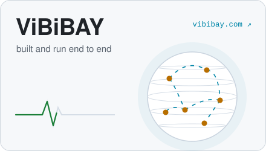

<picture>
  <source media="(prefers-color-scheme: dark)" srcset="assets/hero-dark.svg">
  
</picture>

  <a href="https://learn.prod-factory.ru"><picture><source media="(prefers-color-scheme: dark)" srcset="assets/card-tot-dark.svg"></picture></a>
  <a href="https://vibibay.com"><picture><source media="(prefers-color-scheme: dark)" srcset="assets/card-vibibay-dark.svg"></picture></a>

  <picture>
    <source media="(prefers-color-scheme: dark)" srcset="https://skillicons.dev/icons?i=kubernetes%2Cdocker%2Clinux%2Cansible%2Cgithubactions%2Cgitlab%2Cprometheus%2Cnginx%2Cbash%2Cgo%2Cpostgres%2Credis&theme=dark">
    
  </picture>

<picture>
  <source media="(prefers-color-scheme: dark)" srcset="https://raw.githubusercontent.com/Stxanskiy/Stxanskiy/output/contrib-dark.svg">
  
</picture>

  
  

