<picture>
  <source media="(prefers-color-scheme: dark)" srcset="assets/header-dark.svg">
  
</picture>

I'm Timur, a **DevOps engineer**. I build and run infrastructure: Kubernetes with GitOps through ArgoCD, CI/CD pipelines, secrets in Vault, Prometheus alerts, and a fleet of Linux servers across five countries. I also write **Go**, enough to ship the services that live on that infrastructure.

Right now I'm building **TOT**, a platform where people learn DevOps by doing it in a real terminal, and I run the infrastructure behind **ViBiBAY**.

## TOT

<picture>
  <source media="(prefers-color-scheme: dark)" srcset="assets/tot-lab-dark.svg">
  
</picture>

**TOT** · [learn.prod-factory.ru](https://learn.prod-factory.ru) — a hands-on platform with courses on Linux, Git, Docker, Kubernetes, Helm, Ansible, GitLab CI and PostgreSQL, where every lesson ends in a lab. The Go backend, **[GoLearn](https://github.com/Stxanskiy/GoLearn)**, gives each student their own sandbox: a Firecracker micro-VM in production, a container with no network locally. Docker and Kubernetes labs run a real Docker Engine and a single-node k3s inside it. Every task is checked by a shell probe, and exit code 0 means solved. Students work in a terminal right in the browser.

Go · chi · pgx · PostgreSQL 16 · Firecracker · Docker · k3s · S3 storage · Prometheus metrics · Next.js + xterm.js · CI on GitHub Actions

## Stack

<picture>
  <source media="(prefers-color-scheme: dark)" srcset="https://skillicons.dev/icons?i=kubernetes%2Cdocker%2Clinux%2Cansible%2Cgithubactions%2Cgitlab%2Cprometheus%2Cnginx%2Cbash%2Cgo%2Cpostgres%2Credis&theme=dark">
  
</picture>

| Area | Tools |
|---|---|
| **Kubernetes & GitOps** | Kubernetes · k3s · ArgoCD · Kustomize (base + overlays) · sealed-secrets · Vault |
| **CI/CD** | GitHub Actions (build, staging and prod deploys) · GitLab CI |
| **Servers & network** | Linux · Ansible · Docker · Nginx · WireGuard · Firecracker |
| **Observability** | Prometheus · Alertmanager · OpenTelemetry |
| **Code** | Go (gin, chi, pgx, asynq) · PostgreSQL · Redis · MinIO / S3 · Bash · Python |

## Selected work

| Project | What it is |
|---|---|
| **TOT** backend: | DevOps learning platform with hands-on labs in isolated micro-VMs. Infrastructure, sandbox images, lab checks and the Go API. |
| **ViBiBAY** private | Infrastructure of the service: a fleet of Linux servers in five countries provisioned with Ansible, services on Kubernetes deployed by ArgoCD with staging and prod, secrets in Vault, Prometheus alerting. Plus the Go backend, Telegram bot and payments. |
| **Client projects** private | Containerised Go services with GitLab CI pipelines and Docker deploys for several commercial products. |

## Contact

